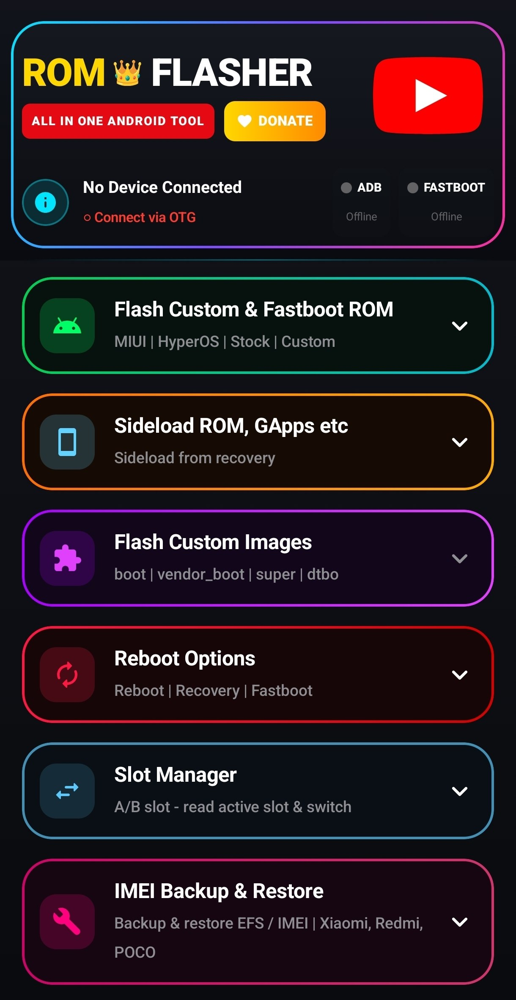
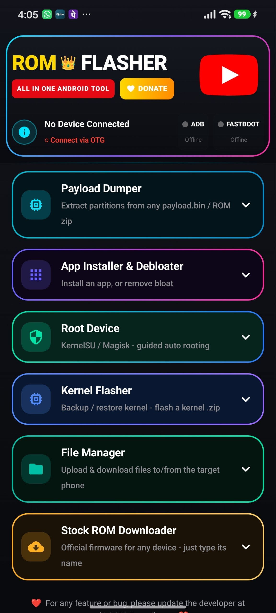

# ROM Flasher Tool

**Flash Fastboot & custom ROMs — Android → Android, over USB-OTG. No PC. No Termux.**

---

## 🎉 Unlocked for Everyone

> **The 2,000-subscriber milestone is COMPLETE! 🎉**
> The **[Rom Flasher YouTube channel](https://www.youtube.com/channel/UC-Oc7NNVa0oW3nHI1L-3oKQ)** crossed **2,000 subscribers**, so the app is now **fully unlocked for everyone** — no lock screen, no unlock code, nothing to enter.

A huge thank you to every single subscriber who made this happen. ❤️ Download the latest release and enjoy the full tool. Subscribing (and sharing the tool) still helps the channel a lot.

---

## 📺 YouTube

<!-- YT-SUBS:START -->

<!-- YT-SUBS:END -->

<!-- YT-VIDEO:START -->

<a href="https://www.youtube.com/watch?v=pxp_m6uAgug"><b>🔥 Backup &amp; Flash ANY Android Kernel in 1 CLICK?! 😱 No APK, No Commands!</b></a> 
🔥 LATEST&nbsp;&nbsp;·&nbsp;&nbsp;📅 17 Oct 2026
 
 

<a href="https://www.youtube.com/watch?v=v5adFI2we2M"><b>PixelExperience Plus For MI PAD 5 | Android 13 |</b></a> 
🏆 MOST WATCHED&nbsp;&nbsp;·&nbsp;&nbsp;👀 19,002 views
 
 

<a href="https://www.youtube.com/watch?v=NUjIiqviMd0"><b>Flash TWRP on Xiaomi 11T PRO  Best Recovery</b></a> 
❤️ MOST LIKED&nbsp;&nbsp;·&nbsp;&nbsp;♥ 110 likes
 
<!-- YT-VIDEO:END -->

> 🤖 This block keeps itself up to date — the subscriber count, the newest video and the all-time top videos refresh on their own.

---

## 📖 What is ROM Flasher Tool?

An **Apple/iOS-grade Jetpack Compose** app that turns one Android phone into a complete flashing station. Plug the target device into the host phone over **USB-OTG** and flash Fastboot ROMs, sideload packages, back up EFS/IMEI, rescue boot loops and much more — all from one clean, dark, glassmorphic UI.

Everything runs **on the device**. No PC, no Termux, no root required for the flashing flows (only an unlocked bootloader).

---

## ✨ Features

<b>🚀 Flashing</b>

- **Flash Fastboot ROMs** — full `.bat` / `.sh` flash-script parsing with Windows → Unix path normalisation
- **Sideload ROM / GApps / Magisk** — recovery sideload over USB
- **Flash Custom Images** — `boot`, `init_boot`, `super`, `vbmeta` and more
- **Sparse Chunking Engine** — streams huge partitions (4–8 GB `super.img`) safely
- **A/B Slot Manager** — read and switch active slots
- **Confirm before every risky flash / reboot**

<b>🛠️ Tools & Recovery</b>

- **IMEI / EFS Backup & Restore**
- **Kernel Backup, Restore & Flash**
- **Boot-loop Rescue** — automatic fastboot restore path
- **Root Wizard** — KernelSU / Magisk, straight from the app
- **App Installer** — `.apk` / `.xapk` / `.apkm`
- **Debloater** — remove system bloat
- **File Manager** — upload / download between the two phones
- **Full Device Info**
- **Live CMD Terminal + Logs**

<b>⬇️ Stock ROM Downloader</b>

- **Live, region-wise stock ROM index** — Xiaomi, POCO, OnePlus, OPPO, realme, vivo / iQOO, Google Pixel
- **Clean one-screen ROM picker** — no console, no clutter
- **Recovery + Fastboot ROMs both listed**
- **Search any device by name** (no phone needed)
- **Parallel multi-segment fast download** with automatic **fastest-mirror selection**
- **IDM-style download popup** that keeps running in the background
- **Mirror failover** if speed drops mid-download

<b>🧩 More</b>

- **Payload Dumper + SHA-256 verify**
- **ROM-wise Backup Picker** for safe restores
- **Video guides inside the app**
- **Parallel multi-segment downloads**
- **Buttons stay off until a phone is connected**
- **Cancel a running ROM extraction anytime**
- **Change language anytime** (English / Hinglish) from the 🌐 button

---

## 📱 Screenshots

<table>
  <tr>
    <td align="center"></td>
    <td align="center"></td>
  </tr>
</table>

> More screenshots welcome — drop PNGs/JPGs into [`docs/screenshots/`](docs/screenshots/) and add a row above.

---

## 📲 Install

1. Download the latest **`app-release.apk`** from the [Releases](../../releases) page.
2. On your Android phone, allow **Install unknown apps** for your browser / file manager.
3. Install, open the app, and connect the target phone over a **USB-OTG cable**.

> **Requirements:** Android 8.0 (API 26) or newer · OTG cable · unlocked bootloader for flashing.

---

## ❓ FAQ

<b>Can I flash a ROM without a PC?</b>

Yes. ROM Flasher Tool is a complete **PC-free flashing station** — it runs on one Android phone and talks to the target phone over **USB-OTG**. No laptop, no Termux, no ADB or fastboot scripts on a computer.

<b>Do I need root or a custom recovery?</b>

No. The flashing flows need only an **unlocked bootloader** on the target device. Root is optional — the built-in Root Wizard installs **KernelSU / Magisk** if you want it.

<b>Which phones are supported?</b>

Any device with **fastboot** can be flashed. The built-in **Stock ROM Downloader** has a live, region-wise index for **Xiaomi, POCO, OnePlus, OPPO, realme, vivo / iQOO and Google Pixel**.

<b>Does it work on Samsung?</b>

Samsung phones do not expose a standard **fastboot** path, so the flashing flows do not apply to them. Other brands work normally over fastboot.

<b>Is it free?</b>

Yes — **100% free** to download and use. No account, no ads, no unlock code.

<b>Which Android version do I need?</b>

**Android 8.0 (API 26)** or newer on the host phone, plus a **USB-OTG cable**.

<b>Is it safe? Can it brick my phone?</b>

Every risky action asks for **confirmation first**, and the app keeps a fastboot **boot-loop rescue** path. That said, flashing is inherently risky — always back up, and only flash ROMs built for your **exact device codename**.

---

## 🐞 Found a bug? Have an idea?

Open an **[Issue](../../issues/new/choose)** — bug reports and feature requests both land **directly in my notifications**, and I'll reply right there.

Please include your **app version**, your **phone model**, and what you were doing. Screenshots or the app's terminal log speed things up a lot.

For general questions and chat, use **[Discussions](../../discussions)**.

---

## 🧱 About this repository

This is a **distribution repository** — it hosts the documentation, screenshots and the compiled **release APKs**. The application source code is private and is not published here.

Every release is built from source and signed with a private release key, then R8-obfuscated before publishing.

---

## ▶️ YouTube · ❤️ Support

- 📺 **YouTube:** [Rom Flasher](https://www.youtube.com/channel/UC-Oc7NNVa0oW3nHI1L-3oKQ)
- ⭐ **Star** this repo if the tool helped you
- 💰 **Donate:** UPI QR is inside the app (*Donate* button)

---

## ⚠️ Disclaimer

Flashing firmware is **risky**. Always back up first. You alone are responsible for what happens to your device — the developer is not liable for bricked phones, lost data, or voided warranties. Only flash ROMs meant for **your exact device codename**.

---

© 2026 ROM Flasher Tool · Made with ❤️ in India

